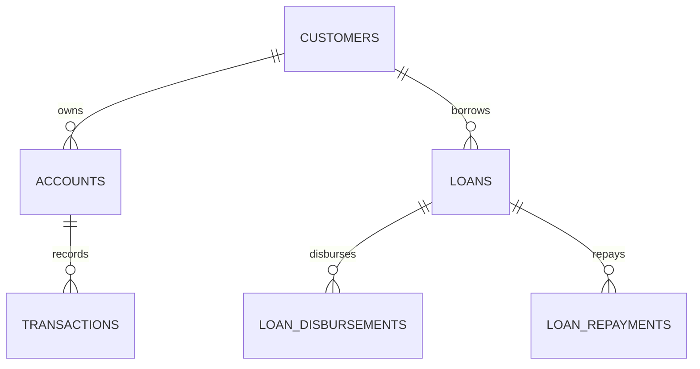

# 银行数据平台 V0.1｜第一周集成验收报告

> 项目：bank-data-platform  
> 阶段：D01–D07（第一周）  
> 版本：v0.1  
> 验收日期：2026-10-25  
> 状态：**待执行最终集成验收**（将下文的待填写内容替换为实际结果后，再标记通过）

## 1. 项目概述

本项目面向零售银行常见的数据处理与业务统计场景，围绕客户、账户、交易、贷款、放款和还款数据，构建一套可本地运行的 PostgreSQL + Python 基础业务数据平台。第一周聚焦源数据模型、模拟数据生成、约束校验、批量导入和基础 SQL 分析。

**第一周目标：** 从空数据库依次完成数据库初始化 → 创建源表 → 生成模拟数据 → 校验数据 → 导入数据 → 执行六类业务查询，并保存可复现的运行说明。

**技术栈：** Python、PostgreSQL、psycopg、Faker、NumPy、python-dotenv、Git。

## 2. 本周实现内容

| 天数 | 工作内容 | 关键产物 | 状态 |
|---|---|---|---|
| D01 | 明确项目目标、组织项目目录、初始化 Git | `README.md`、项目结构 | 已完成（按开发记录） |
| D02 | Python/PostgreSQL 环境、数据库连接、环境变量 | `.env.example`、`scripts/check_db.py` | 已完成（按开发记录） |
| D03 | 业务 ER 图、表关系和数据字典 | `docs/er_diagram.md`、`docs/data_dictionary.md` | 已完成（按开发记录） |
| D04 | 源表 DDL、主外键/CHECK/UNIQUE 约束及异常验证 | `sql/source/001_schema.sql` 等 | 已完成（按开发记录） |
| D05 | Faker + NumPy 数据生成、质量校验、导入 PostgreSQL | 数据生成与导入脚本、配置文件 | 已完成（按开发记录） |
| D06 | 六类业务 SQL 分析 | `sql/analysis/01_06.sql` | 已完成（按开发记录） |
| D07 | 从空库复现、执行计划检查、整理文档、发布标签 | `docs/week1_demo.md`、Git tag `v0.1` | 待最终验收 |

> 路径以本机实际文件为准。若脚本名称与此文不同，请统一 README、本文和命令。

## 3. 核心业务模型

### 3.1 实体关系



- 一个客户可以拥有多个账户。
- 一条交易归属一个账户。
- 一笔贷款归属一个客户（若实际 DDL 采用账户关联贷款，请以 DDL 为准）。
- 一笔贷款可以对应多条放款记录和多条还款记录。
- 交易、放款和还款是事件记录；业务状态应通过字段表达，不直接覆盖历史事件。

### 3.2 数据字典与约束

详细字段定义见 [`data_dictionary.md`](./data_dictionary.md)，ER 图见 [`er_diagram.md`](./er_diagram.md)。重点核对：

- 主键不可重复且不能为空。
- 外键必须引用已存在的客户、账户或贷款记录。
- 金额字段应使用适合金额的定点数类型，并通过 CHECK 控制范围。
- 成功还款的业务日期不得早于其对应贷款的放款日期（若未在数据库层实现跨表检查，应由 Python 数据校验完成）。
- 状态值仅允许预先约定的取值。
- 时间戳、业务日期、货币单位采用统一约定（填入实际约定：**待填写**）。

## 4. 干净环境复现流程

### 4.1 前置条件

- 已安装 Python、PostgreSQL 与 Git。
- PostgreSQL 服务已启动，且可使用有建库权限的账户连接。
- 本仓库已包含实际的建表 SQL、数据生成、校验、导入和分析脚本。
- 本地创建 `.env`，不得将真实数据库密码提交到 Git。

Windows PowerShell 参考命令：

```powershell
# 进入项目根目录
cd D:\code\bank-data-platform

# 激活已创建的虚拟环境（路径按实际环境修改）
.\.venv\Scripts\Activate.ps1

# 安装项目依赖
pip install -r requirements.txt

# 如果提供了环境变量示例，复制后修改参数
Copy-Item .env.example .env
```

`.env` 中应配置实际脚本使用的环境变量名，例如：

```dotenv
DB_HOST=localhost
DB_PORT=5432
DB_NAME=bank_dev
DB_USER=postgres
DB_PASSWORD=请替换为本地密码
```

> 注意：若连接脚本使用的是 `DB_NAME` 以外的变量名（如 `DB_DBNAME`），必须与代码保持一致。上面仅是配置示例。

### 4.2 创建空数据库与 schema

在 PostgreSQL 管理工具或 `psql` 中执行：

```sql
CREATE DATABASE bank_dev;
```

随后连接到 `bank_dev`，如需创建分层 schema，可执行：

```sql
CREATE SCHEMA IF NOT EXISTS source;
CREATE SCHEMA IF NOT EXISTS ods;
CREATE SCHEMA IF NOT EXISTS dwd;
CREATE SCHEMA IF NOT EXISTS dws;
CREATE SCHEMA IF NOT EXISTS ads;
```

> 仅在**新建的测试数据库**中执行初始化；不要对现有业务库运行清空/删除操作。第一周实际使用的是 `source` 源表，其余 schema 为后续扩展预留。

### 4.3 执行 DDL 建表

使用 `psql` 的参考命令：

```powershell
psql -h localhost -U postgres -d bank_dev -f sql/source/001_schema.sql
```

若实际建表 SQL 分散于多个文件，请按依赖顺序依次执行。建表后确认六张表存在：

```sql
SELECT table_name
FROM information_schema.tables
WHERE table_schema = 'source'
ORDER BY table_name;
```

预期业务表：`customers`、`accounts`、`transactions`、`loans`、`loan_disbursements`、`loan_repayments`。

### 4.4 生成并校验数据

以下是**参考命令**，以实际仓库脚本路径和参数为准：

```powershell
python data_generator/generate.py
```

执行现有的数据质量校验脚本（文件路径：**待填写**），至少检查：

1. 主键非空且无重复。
2. 所有外键能正确关联。
3. 金额和状态符合业务规则。
4. 交易、放款和还款日期符合逻辑。
5. 固定随机种子重复生成时得到一致数据（在相同代码和依赖环境下）。

将真实输出填入：

| 指标 | 实际结果 |
|---|---|
| 随机种子 | 待填写 |
| 客户数 | 待填写（目标约 1,000） |
| 账户数 | 待填写 |
| 交易数 | 待填写 |
| 贷款数 | 待填写 |
| 放款记录数 | 待填写 |
| 还款记录数 | 待填写 |
| 数据质量校验 | 待运行 / 待填写 |

### 4.5 导入数据

运行已有导入脚本（路径：**待填写**）。

导入顺序推荐：`customers` → `accounts` → `loans` → `transactions`、`loan_disbursements`、`loan_repayments`；最终顺序必须满足实际 DDL 外键依赖。

导入后用 SQL 核对记录数：

```sql
SELECT 'customers' AS table_name, COUNT(*) AS row_count FROM source.customers
UNION ALL
SELECT 'accounts', COUNT(*) FROM source.accounts
UNION ALL
SELECT 'transactions', COUNT(*) FROM source.transactions
UNION ALL
SELECT 'loans', COUNT(*) FROM source.loans
UNION ALL
SELECT 'loan_disbursements', COUNT(*) FROM source.loan_disbursements
UNION ALL
SELECT 'loan_repayments', COUNT(*) FROM source.loan_repayments;
```

核对导入记录数与生成文件的有效记录数是否一致，并记录缺失/重复/拒绝行。

### 4.6 执行六个业务查询

```powershell
psql -h localhost -U postgres -d bank_dev -f sql/analysis/01_06.sql
```

确保六个查询均可运行，且已核对 JOIN 关系、去重口径、成功状态筛选及日期范围。

## 5. 六个业务查询验收

| 序号 | 查询主题 | 业务口径检查 | 示例输出/结果文件 |
|---|---|---|---|
| 01 | 月交易额 | 按月汇总符合条件的交易金额，明确成功状态与时间范围 | 待填写 |
| 02 | 月活跃客户数 | 通过 `transactions.account_id = accounts.account_id` 关联，`COUNT(DISTINCT customer_id)` | 待填写 |
| 03 | 分地区客户数 | 客户按地区分组，检查缺失地区值 | 待填写 |
| 04 | 客户交易排行 | 先按客户聚合金额或笔数，再排序 | 待填写 |
| 05 | 贷款发放额 | 只累计成功放款记录，避免与还款明细直接 JOIN 重复求和 | 待填写 |
| 06 | 未结清贷款数 | 以累计成功放款本金减累计成功偿还本金计算未结清额，再统计贷款笔数 | 待填写 |

**重点验证：** 若一笔贷款有多次放款和多次还款，不能把两张明细表直接连接后求和；应分别按 `loan_id` 聚合，再关联。

> 此处填入每个查询的**实际 SQL 输出摘要**，并可在 `docs/week1_outputs/` 中保存 CSV 或截图。当前未运行本地数据库，不能将示例结果视为已验证数据。

## 6. PostgreSQL EXPLAIN 基础验收

选取一个简单筛选查询和一个聚合/JOIN 查询，比较执行计划。

### 6.1 单表筛选

```sql
EXPLAIN (ANALYZE, BUFFERS)
SELECT *
FROM source.transactions
WHERE account_id = 1001;
```

### 6.2 按账户聚合交易

```sql
EXPLAIN (ANALYZE, BUFFERS)
SELECT account_id, COUNT(*) AS transaction_count
FROM source.transactions
GROUP BY account_id;
```

观察并记录：

| 项目 | 查询 1 | 查询 2 |
|---|---|---|
| 扫描方式（Seq Scan / Index Scan 等） | 待填写 | 待填写 |
| 估计行数 / 实际行数 | 待填写 | 待填写 |
| Planning Time | 待填写 | 待填写 |
| Execution Time | 待填写 | 待填写 |
| 是否存在聚合/排序节点 | 待填写 | 待填写 |

**理解要点：** `EXPLAIN` 给出预计计划；`EXPLAIN ANALYZE` 会真正执行 SQL 并输出真实运行信息。小样本表出现顺序扫描并不必然表示性能问题。

## 7. 异常场景验收

| 测试项 | 预期行为 | 实际结果 |
|---|---|---|
| 重复主键 | INSERT 被拒绝 | 待填写 |
| 不存在的外键 | INSERT 被拒绝 | 待填写 |
| 负金额（受 CHECK 约束的字段） | INSERT 被拒绝 | 待填写 |
| 非法状态值 | INSERT 被拒绝 | 待填写 |
| 还款日期早于放款日期 | 在生成器/校验器中标识或拒绝 | 待填写 |
| 重复执行导入 | 明确是拒绝、忽略还是幂等更新，不产生静默重复数据 | 待填写 |

## 8. 遇到的问题与解决记录

| 问题 | 原因/分析 | 解决方法 | 当前状态 |
|---|---|---|---|
| PowerShell 启动数据库脚本发生乱码/引号错误 | 脚本文本编码问题导致字符串被错误解释 | 修复脚本编码与字符串后重试 | 已解决（根据此前开发记录） |
| Git Push 无法连接 GitHub 443 端口 | 本地终端连接异常，浏览器可访问不代表 Git 网络畅通 | 核查 Git/代理和网络配置，最终推送是否成功需复核 | 待确认 |
| 其他集成错误 | 待填写 | 待填写 | 待填写 |

## 9. Git 版本封存

在完成复现、确认敏感文件被正确忽略后，执行：

```powershell
git status
git add README.md docs sql data_generator scripts config requirements.txt .env.example
git status
git commit -m "docs: complete week 1 integration"
git push origin main
git tag -a v0.1 -m "Week 1 integration completed"
git push origin v0.1
```

> 上面的 `git add` 使用常见目录示例；请按仓库实际目录增减。**不要提交 `.env`、数据库密码和大量生成数据**。如果某个目录或文件不存在，删除对应参数。若没有新变化则不需要强制 `commit`；确认标签标记的是目标提交即可。

版本确认命令：

```powershell
git status
git log -1 --oneline
git tag -n
git remote -v
```

- 当前 commit：**待填写**
- 远程仓库：**待填写**
- `v0.1` 标签：**待推送 / 待确认**

## 10. 第一周验收结论

### 验收检查表

- [ ] 能从全新测试数据库执行全部建表 SQL。
- [ ] 生成数据通过外键、金额、状态和日期校验。
- [ ] 生成的数据成功导入 PostgreSQL，记录数一致。
- [ ] 六个业务查询可运行且输出正确。
- [ ] 至少两个 SQL 的 EXPLAIN ANALYZE 结果已记录。
- [ ] README 包含所有真实、可运行的复现命令。
- [ ] ER 图与数据字典和实际 DDL 保持一致。
- [ ] 不依赖旧数据或手工隐含步骤即可复现。
- [ ] Git 主分支已推送，`v0.1` 标签已发布。

**验收结论：** 待最终执行后填写（通过 / 有条件通过 / 未通过）。

**下一阶段方向：** 在现有 `source` 业务源表的基础上，逐步建设 ODS → DWD → DWS → ADS 数据分层，并将基础 SQL 查询规范化为可复用的银行业务指标。
